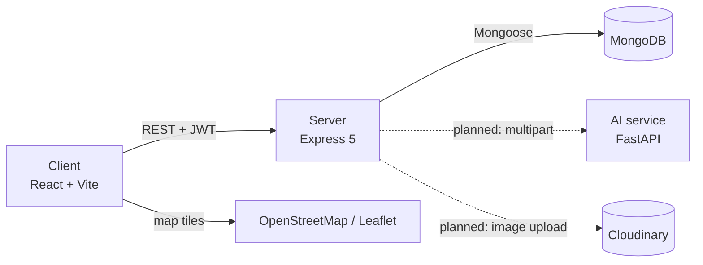
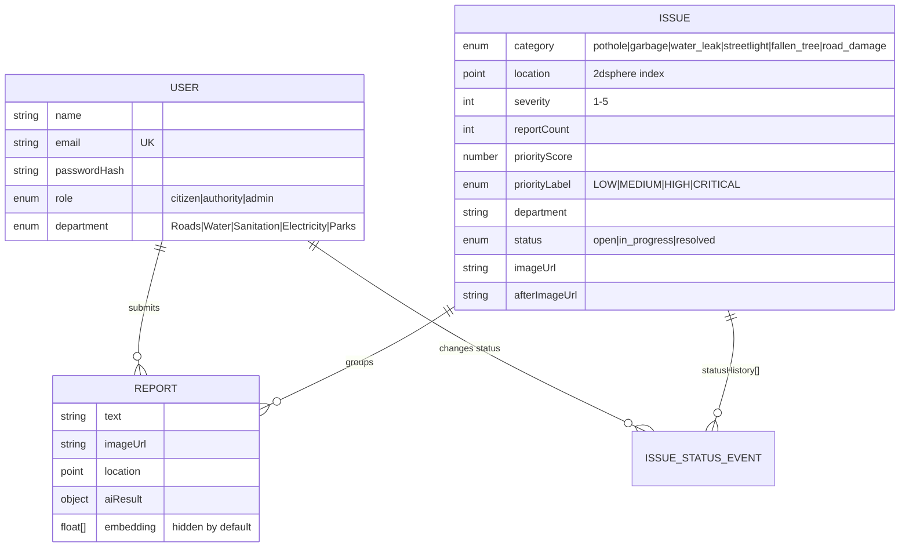
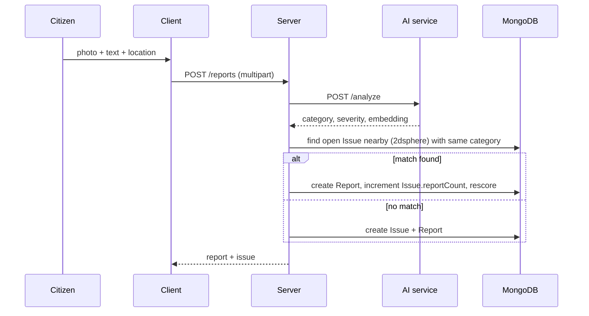

# CivicEye architecture

## Overview

CivicEye is three independently runnable services around one MongoDB database.

Solid lines exist today; dashed lines are planned.

## Components

### Client (`client/`)
- Vite + React 19 SPA styled with Tailwind 4.
- `AuthContext` stores the JWT in `localStorage`, restores the session through `GET /auth/me` on load, and exposes `login`, `register`, `logout`.
- `api/axios.js` attaches `Authorization: Bearer <token>` to every request.
- `ProtectedRoute` guards routes by login state and optional role list.
- Routes: `/login`, `/register`, `/report` (any signed-in user), `/dashboard` (`authority`, `admin`).
- `Report` and `Dashboard` pages are placeholders; Leaflet is installed for the future map.

### Server (`server/`)
- `src/app.js` wires CORS, JSON parsing, `/api/health` and `/api/auth`. It exports `app` so tests can mount it, and only listens when `NODE_ENV !== "test"`.
- `routes/auth.js` validates input with Zod, hashes passwords with bcrypt (cost 10), and issues 7-day JWTs containing `id` and `role`. Registration always creates a `citizen`; privileged accounts come from `seed.js`.
- `middleware/auth.js`: `requireAuth` verifies the token and loads the user (so deleted users lose access immediately); `requireRole(...roles)` returns 403 for other roles.

### AI service (`ai-service/`)
- `POST /analyze` takes `text` and an optional `image` and returns `category`, `severity`, `confidence`, `context`, `duration_days`, `summary` and a 384-dimension `embedding` (MiniLM).
- The classification fields are currently hard-coded; only the embedding is real. The embedding is intended for semantic duplicate detection.

## Data model

- An **Issue** is the real-world problem; many **Reports** from different citizens can point to one Issue (`reportCount`, `priorityScore`).
- `location` uses GeoJSON `[lng, lat]`; Issue has a `2dsphere` index to support "nearby open issue" lookups.
- `statusHistory` on Issue is an embedded audit trail (status, who, when, note).

## Authentication and authorization

1. `POST /auth/login` returns a JWT; the client sends it as a Bearer token.
2. `requireAuth` verifies the signature and expiry, then loads the user from MongoDB.
3. Role checks happen server-side (`requireRole`) and are mirrored client-side (`ProtectedRoute`) for UX only.

## Planned report flow

## Testing strategy

| Suite | Scope | Tooling |
|---|---|---|
| `server/tests/models.test.js` | Schema validation and defaults, no DB needed | `node --test` |
| `server/tests/auth.test.js` | Register, login, `/me`, role-escalation guard | supertest + in-memory MongoDB |
| `ai-service/tests/test_main.py` | `/health`, `/analyze` response contract | pytest, FastAPI TestClient, stubbed model |

## Known limitations and next steps

- If `CLIENT_URL` is unset, the `cors` package allows any origin; set it in every environment.
- No rate limiting or security headers yet (consider `express-rate-limit` and `helmet`).
- The JWT lives in `localStorage`, which is exposed to XSS; an HttpOnly cookie is the stronger option.
- `ProtectedRoute` redirects wrong-role users to `/`, which has no route and falls through to `/login`; add a home or "forbidden" page.
- Authority users are not yet restricted to their own `department` on issues.
- Build next: report submission with image upload, a real classifier behind `/analyze`, clustering, the map, and the dashboard.
